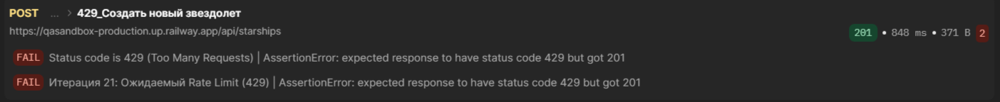

##  [BUG-009]🕷️[API][cargo] Functional Negative Testing: Сервер обновляет данные груза с ошибкой валидации

**Ссылка на Jira:** [Открыть задачу в Jira]()  

**Приоритет:** Medium ⚠️

**Cреда:** PC/OS Windows 10Pro/64bit Google Chrome (v. 148.0.7778.179)/1920х1080 

## 🛠 Конфигурация тестирования:
* **Environment:** `QA`
* **Инструмент запуска::** `Newman v6.2.2`, `Postman App`
* **Postman:** [API Automation Framework: Security Audit, Stress & Logic | Oort Depot](https://www.postman.com/bel-test-qa-1996072/api-automation-framework-security-audit-stress-logic-oort-depot)

## 🟪 Preconditions:
> Authorization:
* {{bearerToken}} - “666777888”
  
## ☑️ Steps to Reproduce:
* Шаг 1: Открыть коллекцию Postman [Ultimate API Quality Gate | Oort Depot](https://www.postman.com/bel-test-qa-1996072/api-automation-framework-security-audit-stress-logic-oort-depot/collection/5083vdu/ultimate-api-quality-gate-oort-depot?action=share&creator=51804164&active-environment=51804164-40b20e69-ba89-4ed1-84e1-9819229903cf)
* Шаг 2: Открыть папку [Perfomance Stress & Rate Limiting](https://www.postman.com/bel-test-qa-1996072/api-automation-framework-security-audit-stress-logic-oort-depot/folder/hg7616v/perfomance-stress-rate-limiting).
* Шаг 3: Перейти во вложенную папку [Rate Limiting Check](https://www.postman.com/bel-test-qa-1996072/api-automation-framework-security-audit-stress-logic-oort-depot/folder/b8753yg/rate-limiting-check)
* Шаг 4: Нажать на три точки возле названия папки -> выбрать **Run folder**.
* Шаг 5: Нажать кнопку **Start Run**. 

## 🖥️ Команда для локального запуска в терминале:
```bash
npx newman run ultimate_api.postman_collection.json -e qa_postman_environment.json -r cli,htmlextra --reporter-htmlextra-export report.html
```

## ✅ Expected Result:
> 1. Cервер возвращает ответ на 21-ой иттерации status code `429 Too Many Requests`
> 2. Test Results: `PASS` "429 Too Many Requests", `PASS` Итерация 21: Ожидаемый Rate Limit (429)"

## ❌ Actual Result:
> [!CAUTION]
> 1. Сервер вернул ответ status code `201 OK`
>
> 2. Response Body: вернул поля с информацией о созданном коробле
>
> 3. Test Results: `FAIL` “"Status code is 429 (Too Many Requests) | AssertionError: expected response to have status code 429 but got 201", `FAIL` .

## Attachments:

